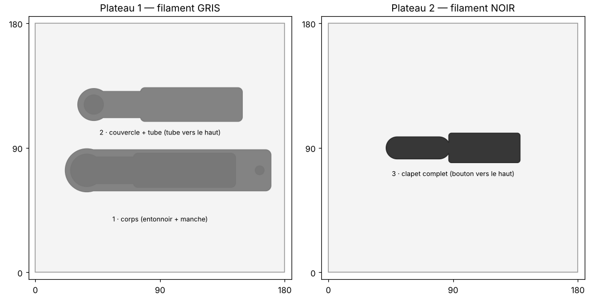

# Dozr — guide d'impression

3 pièces, **aucun support**, toutes déjà orientées et posées à plat. Elles rentrent sur un plateau 180 × 180 mm.

## Fichiers à ouvrir dans le trancheur (Bambu Studio, PrusaSlicer, Cura, OrcaSlicer)

| Fichier | Contenu | Filament |
|---|---|---|
| `plateau_1_gris.3mf` | corps (entonnoir + manche) + couvercle avec tube | gris |
| `plateau_2_noir.3mf` | clapet complet (languette + bouton) | noir |
| `plateau_complet_multicolore.3mf` | les 3 pièces ensemble (imprimante multicolore / AMS : mettre le clapet en noir) | gris + noir |
| `stl/*.stl` | les pièces une par une, même orientation | |

## Réglages

| | Corps | Couvercle + tube | Clapet |
|---|---|---|---|
| Matière | PETG (contact alimentaire) ou PLA | idem | idem |
| Buse / couche | 0,4 / 0,16 mm (cannelures plus nettes) ou 0,2 | 0,4 / 0,2 | 0,4 / 0,2 |
| Périmètres | 3 | 3 | 4 |
| Remplissage | 15–20 % gyroïde | 20 % | 40 % |
| Supports | **non** | **non** | **non** |
| Bordure (brim) | conseillée (3 mm) si le PETG décolle | non | non |
| Ponts | ventilation à fond (canal de 16–23 mm sous le manche) | — | — |

## Avant de tout imprimer

Le clapet doit glisser sans forcer : jeu de 0,3 mm par côté. Si ton imprimante « bave » un peu (PETG),
régénère avec `CLR = 0.4` dans `dozr.py` puis `python3 dozr.py`.

## Montage

1. Retourner le corps. Poser le clapet dans le canal par dessous : le bouton sort par la fenêtre du manche, la languette va sous l'entonnoir.
2. Mettre un filet de colle (cyano gel ou époxy) **sur le pourtour du couvercle uniquement**, jamais dans le canal, et le presser dans son logement sous le corps. Laisser sécher.
3. Tester : bouton côté entonnoir = fermé, tiré vers le bout du manche = ouvert.
4. Optionnel : passer un feutre noir dans la gravure DOZR® et essuyer le dessus.
