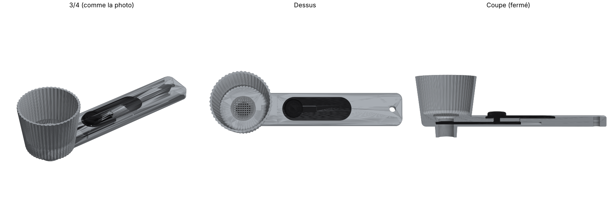

# Dozr — doseur à poudre imprimable en 3D

Reproduction de la forme du visuel produit : entonnoir évasé cannelé (dehors et dedans), fond arrondi,
tamis rond au centre du fond, manche plat avec une longue fente noire en pilule, bouton rond noir côté
entonnoir et trou de suspension au bout. Le bec s'emboîte dans un goulot de bouteille standard.

## Fichiers

| Fichier | Contenu | Couleur |
|---|---|---|
| `stl/1_corps_inferieur.stl` | Dessous : fond, bec, canal de la languette (orienté bec en l'air) | gris |
| `stl/2_corps_superieur_entonnoir.stl` | Entonnoir cannelé + dessus du manche | gris |
| `stl/3_languette.stl` | Languette coulissante qui ferme le bec + tige du bouton | noir |
| `stl/4_bouton.stl` | Bouton rond avec cercle intérieur | noir |
| `stl/5_tamis.stl` | Grille ronde Ø23 (trous 1,2 mm) | gris acier |
| `stl/6_insert_noir.stl` | Pilule noire collée dans le manche | noir |
| `dozr_assemblage.3mf` / `.glb` / `.stl` | Vue assemblée en couleurs | |
| `dozr.py` | Source paramétrique : modifier les cotes en tête de fichier puis `python3 dozr.py` | |

## Dimensions

- Longueur totale 175 mm, manche 30 × 9 mm
- Entonnoir Ø56 mm en haut, Ø44 mm en bas, hauteur 46 mm, 48 cannelures
- Pilule 64 × 22 mm, bouton Ø17 mm
- Bec Ø20,5 → 19 mm, longueur 10 mm, passage Ø14 mm
- Bouton côté entonnoir (comme sur la photo) = **fermé** ; tiré de 18 mm vers le bout du manche = **ouvert**

## Impression

- PETG (contact alimentaire, meilleur glissement) ou PLA, buse 0,4, couches 0,2 mm, **sans supports**
- Sans imprimante multicolore : imprimer les pièces noires en filament noir, le reste en gris
- Le tamis : couches 0,16 mm conseillées pour des barreaux propres
- Jeu de coulissement : 0,3 mm par côté (`CLR` dans `dozr.py`). Si la trappe force, monter à 0,4.

## Assemblage

1. Mettre la languette dans le canal du corps inférieur, tige vers le haut.
2. Insérer 6 tiges Ø2 × 3,5 mm (bouts de filament 1,75 ou trombone) dans les trous d'alignement.
3. Encoller le pourtour du corps inférieur (cyano ou époxy, **pas dans le canal**) et poser le corps supérieur : la tige passe dans la fente.
4. Coller l'insert noir dans la cuvette en pilule du manche.
5. Emmancher le bouton sur la tige (une goutte de colle si le serrage est léger).
6. Poser le tamis dans son logement au fond de l'entonnoir (affleurant, retirable pour le nettoyage).
